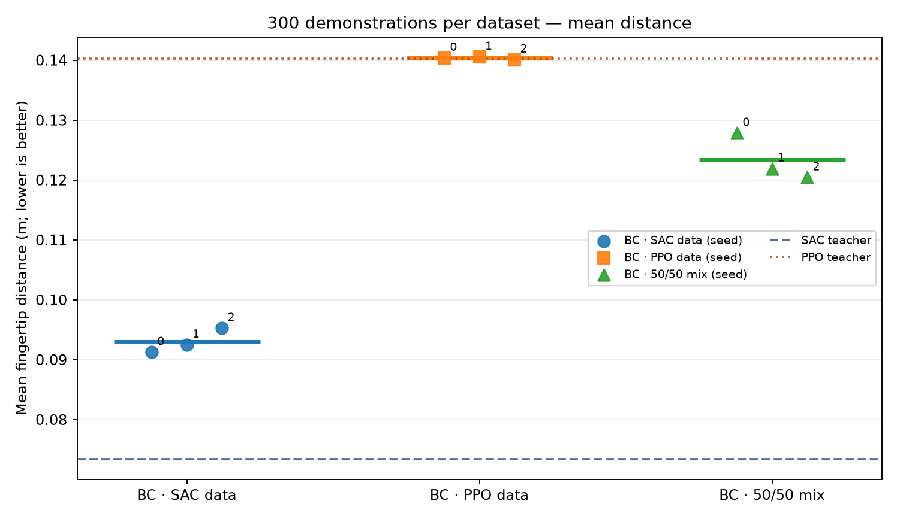

# Reacher-v5: How Does Demonstration Quality & Quantity Affect Imitation Learning?

In this project, Behaviour Cloning (BC) is applied to the Reacher-v5 robotic control task to investigate how quality of demonstration source and dataset size affect the performance of learned policies.

> **Research questions:** 

> 1. Does selecting demonstrations with better reaching outcomes improve a 
> learned policy compared with training on lower-performing or randomly 
> selected demonstrations?

> 2. Does quantity of demonstartions in different variations of demonstration affect on performance 
> of learned imitation learning policy?


## Main Experiment Steps


  

### Step 1: Collect Expert Deterministics

Deterministics have been collect from two expertes policies from SAC, ppo, and mix of both demonstartions that consisit 50% of SAC and 50% of PPO. The trained models are in [Git Repo](https://github.com/mohanafathollahi/SACvsPPO_Reacher-v5) and demosntations have been produced for unique reset seeds (default **10000–10299**).


```bash
python -m scripts.collect   --model ../SACvsPPO_Reacher-v5/models/sac_seed0.zip   --episodes 300 --seed-start 10000 --model_name "sac"

python -m scripts.collect   --model ../SACvsPPO_Reacher-v5/models/ppo_seed0.zip   --episodes 300 --seed-start 10000 --model_name "ppo"

```
Demonstrations created in:

- `data/experts/ppo/trajectories.npz`: transition observations, ppo actions, and episode identifiers.

- `data/experts/sac/trajectories.npz`: transition observations, sac actions, and episode identifiers.

### Step 2: Build Datasets

Build three datasets with the same number of selected trajectories and same seeds as below: 

**High-quality** (smallest final distance)

**Low-quality** (largest final distance)
 
**Random baseline** (mix of high and low quality datasets)

Based on presented results, SAC model could show better performance compared to PPO. Therefore, it conisdted as high quality dataset or demonstrations while PPO considered as low quality datasets. 

Two groups of demonstartions has been conisdred; 150 seeds and 300 seeds. As each episode takes 50 timesteps in 150 seeds experiments we have 7500 demonstrations and for 300 seeds, we have 15000 demonstrations.

```bash
python -m scripts.build_datasets     --source data/experts     --out data/variants     --sizes 300 150     --val-fraction 0.2     --seed 123
```

### Step3: Train Behaviour Cloning
Behavioral Cloning (BC) is a supervised imitation-learning approach in which a policy learns to reproduce the actions of an expert or reference controller from recorded demonstrations.  

BC policies are independently trained for each dataset using three random seeds (0, 1, 2). A neural network maps the robot's 10-dimensional observations to two continuous joint-torque commands by minimizing the Mean Squared Error (MSE) between predicted actions and demonstrated actions. 

The BCPolicy is a fully connected feedforward neural network (Multi-Layer Perceptron, MLP) designed to learn a mapping from observations with size 10 to continuous actions with size 2 through behavioral cloning. It consists of two hidden layers, each containing **128 neurons** with **ReLU activation** functions to capture nonlinear relationships. The output layer contains **Tanh activation** function, constraining the predicted actions to the range \[-1,1]\. During training, the network learns to imitate expert behavior by minimizing the difference between its predicted actions and the corresponding expert actions in the demonstration dataset.


```bash
python -m scripts.train_bc     --dataset data/variants     --sizes 150 300     --out mpython -m scripts.train_bc     --dataset data/variants     --sizes 150 300     --out models     --seeds 0 1 2     --epochs 50     --batch-size 256     --lr 3e-4
```


### Step4: Evalute the BC model

The resulting policies are evaluated on identical held-out Reacher-v5 tasks, seeds from 20000 to 20299 and compared against the original SAC and PPO controllers using episode return, distance to goal,and control cost. This experimental design examines whether the source and quantity of demonstration data influence the effectiveness and generalization of imitation learning.

```bash
python -m scripts.evaluate \
    --models models \
    --sizes 150 300 \
    --seeds 0 1 2 \
    --episodes 300 \
    --test-seed-start 20000 \
    --sac-teacher ../SACvsPPO_Reacher-v5/models/sac_seed0.zip \
    --ppo-teacher ../SACvsPPO_Reacher-v5/models/ppo_seed0.zip \
    --out results/evaluation.csv
```
With 150 demonstrations available for BC training, the high-quality (SAC-generated) dataset achieves a higher episode return and a lower mean distance to the target compared with the low-quality (PPO-generated) and mixed datasets. This highlights the importance of demonstration quality in BC performance.

<p align="center">


</p>
 
However, when the number of demonstrations used for BC training increases to 300, the models trained on the high-quality and mixed datasets improve in terms of both episode return and mean distance to the target, whereas the model trained on the low-quality dataset shows no considerable improvement.


<p align="center">


</p>


### Install
- Python 3.10–3.12 recommended; CPU is fine.

```bash
python -m venv .venv
source .venv/bin/activate  
python -m pip install -r requirements.txt
```


## References

- [Gymnasium Reacher-v5](https://gymnasium.farama.org/environments/mujoco/reacher/)
- [Stable-Baselines3 SAC](https://stable-baselines3.readthedocs.io/en/master/modules/sac.html)
- [Behavioral Cloning (imitation)](https://imitation.readthedocs.io/en/latest/algorithms/bc.html)
