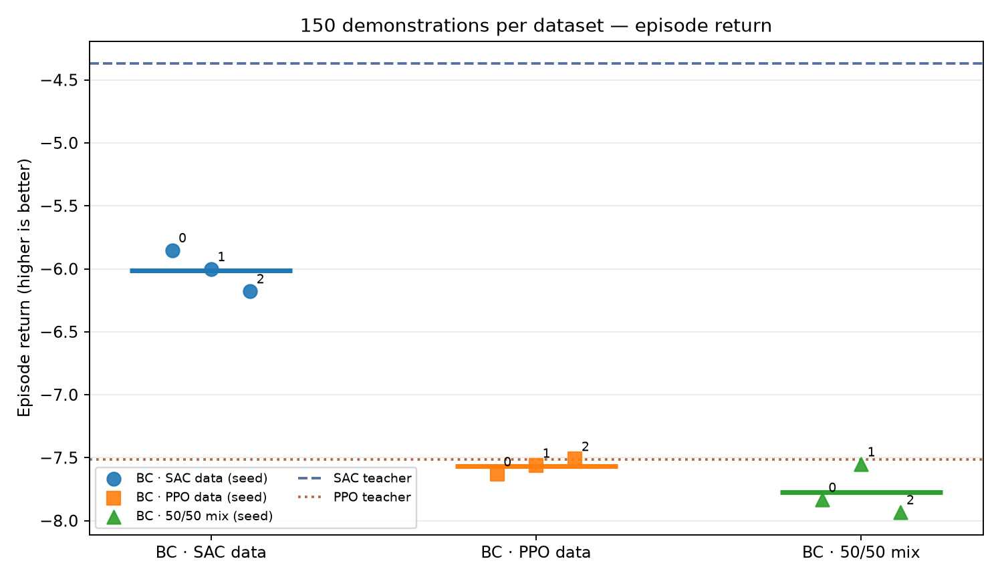
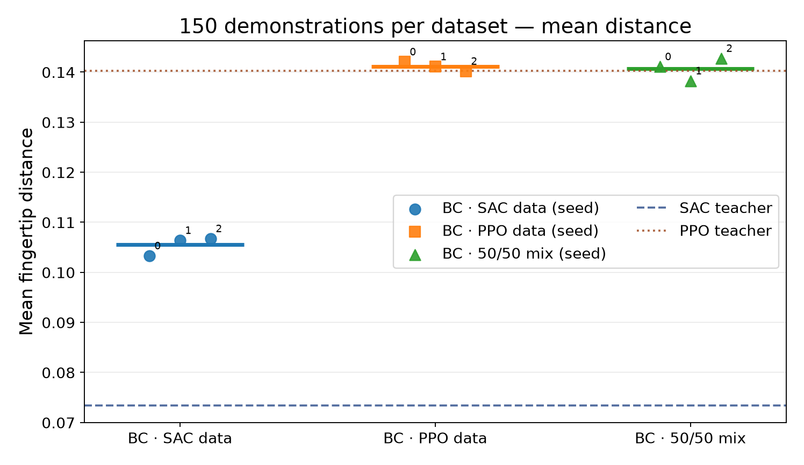
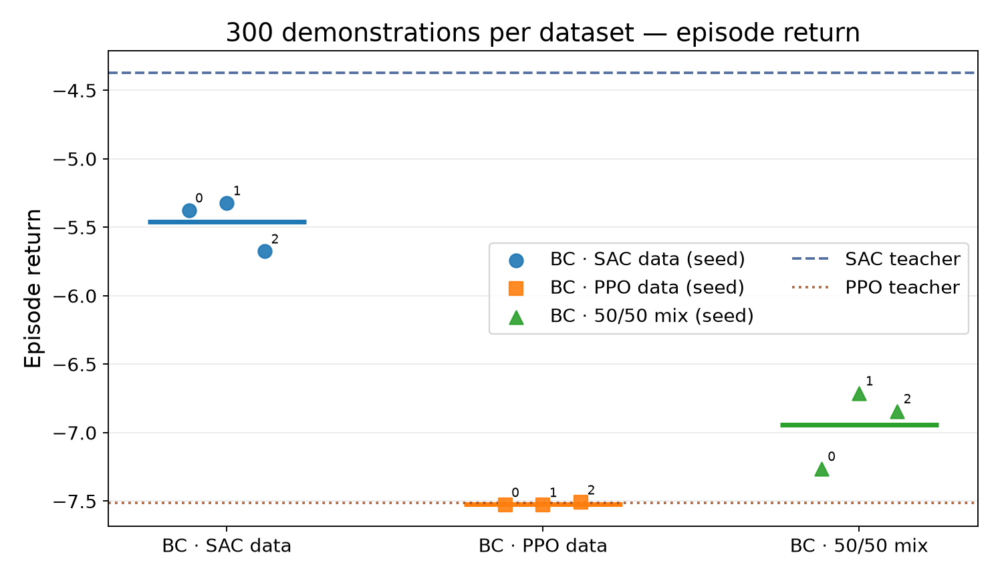
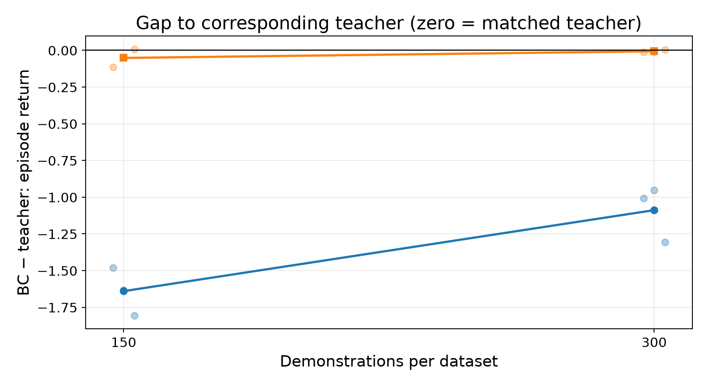
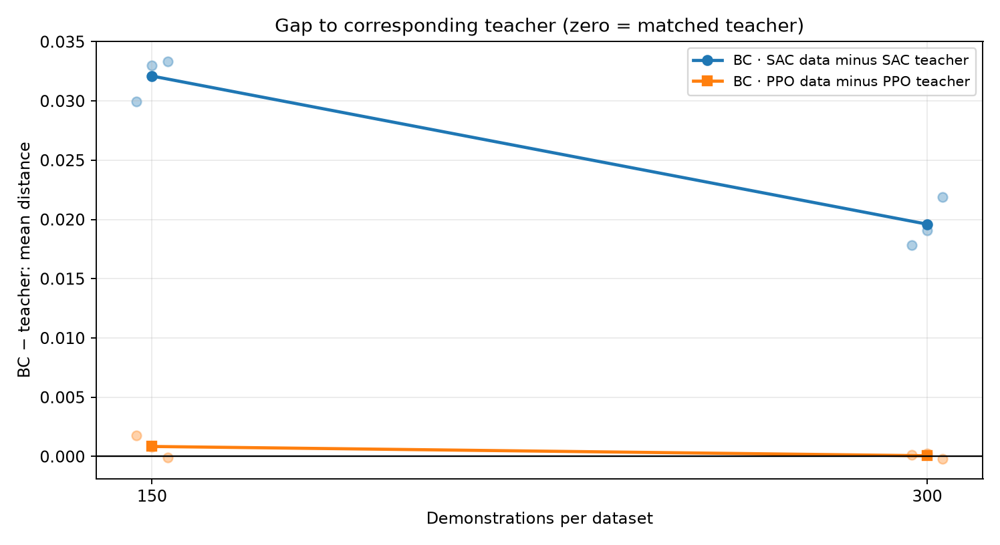

# Reacher-v5: How Does Demonstration Quality & Quantity Affect Imitation Learning?

In this project, Behaviour Cloning (BC) is applied to the Reacher-v5 robotic control task to investigate how quality of demonstration source and dataset size affect the performance of learned policies.

> **Research questions:** 

> 1. Does selecting demonstrations with better reaching outcomes improve a 
> learned policy compared with training on lower-performing or randomly 
> selected demonstrations?

> 2. Does quantity of demonstartions in different variations of demonstration affect on performance 
> of learned imitation learning policy?


## Main Experiment Steps


  

### Step 1: Collect Expert Deterministics

Deterministics have been collect from two expertes policies from SAC, ppo, and mix of both demonstartions that consisit 50% of SAC and 50% of PPO. The trained models are in [Git Repo](https://github.com/mohanafathollahi/SACvsPPO_Reacher-v5) and demosntations have been produced for unique reset seeds (default **10000–10299**).


```bash
python -m scripts.collect   --model ../SACvsPPO_Reacher-v5/models/sac_seed0.zip   --episodes 300 --seed-start 10000 --model_name "sac"

python -m scripts.collect   --model ../SACvsPPO_Reacher-v5/models/ppo_seed0.zip   --episodes 300 --seed-start 10000 --model_name "ppo"

```
### Step 2: Build Datasets

Build three datasets with the same number of selected trajectories and same seeds as below: 

**High-quality** (smallest final distance)

**Low-quality** (largest final distance)
 
**Random baseline** (mix of high and low quality datasets)

Based on presented results, SAC model could show better performance compared to PPO. Therefore, it conisdted as high quality dataset or demonstrations while PPO considered as low quality datasets. 

Two groups of demonstartions has been conisdred; 150 seeds and 300 seeds. As each episode takes 50 timesteps in 150 seeds experiments we have 7500 demonstrations and for 300 seeds, we have 15000 demonstrations.

```bash
python -m scripts.build_datasets     --source data/experts     --out data/variants     --sizes 300 150     --val-fraction 0.2     --seed 123
```

### Step3: Train Behaviour Cloning
Behavioral Cloning (BC) is a supervised imitation-learning approach in which a policy learns to reproduce the actions of an expert or reference controller from recorded demonstrations.  

BC policies are independently trained for each dataset using three random seeds (0, 1, 2). A neural network maps the robot's 10-dimensional observations to two continuous joint-torque commands by minimizing the Mean Squared Error (MSE) between predicted actions and demonstrated actions. 

The BCPolicy is a fully connected feedforward neural network (Multi-Layer Perceptron, MLP) designed to learn a mapping from observations with size 10 to continuous actions with size 2 through behavioral cloning. It consists of two hidden layers, each containing **128 neurons** with **ReLU activation** functions to capture nonlinear relationships. The output layer contains **Tanh activation** function, constraining the predicted actions to the range \[-1,1]\. During training, the network learns to imitate expert behavior by minimizing the difference between its predicted actions and the corresponding expert actions in the demonstration dataset.


```bash
python -m scripts.train_bc     --dataset data/variants     --sizes 150 300     --out mpython -m scripts.train_bc     --dataset data/variants     --sizes 150 300     --out models     --seeds 0 1 2     --epochs 50     --batch-size 256     --lr 3e-4
```


### Step4: Evalute the BC model

The resulting policies are evaluated on identical held-out Reacher-v5 tasks, seeds from 20000 to 20299 and compared against the original SAC and PPO controllers using episode return, distance to goal,and control cost. This experimental design examines whether the source and quantity of demonstration data influence the effectiveness and generalization of imitation learning.

```bash
python -m scripts.evaluate \
    --models models \
    --sizes 150 300 \
    --seeds 0 1 2 \
    --episodes 300 \
    --test-seed-start 20000 \
    --sac-teacher ../SACvsPPO_Reacher-v5/models/sac_seed0.zip \
    --ppo-teacher ../SACvsPPO_Reacher-v5/models/ppo_seed0.zip \
    --out results/evaluation.csv
```

effect of high quality dataset:
<p align="center">


</p>
 
 affect of more demonstrations


<p align="center">


</p>

distance 
<p align="center">


</p>


Evaluate each BC model on the **same 100 held-out initializations** (seeds **20000–20099**) and plot results across the three training seeds.

**Important limitations:** The "quality" labels mean *outcome-based trajectory selection*; 

they are **not ground-truth labels of controller competence**. Hard initial tasks may be overrepresented in the low-quality group. The high/low split does not establish a causal effect of action quality. A random baseline and shared final test set help, but do not eliminate this confound. A stronger follow-up matches datasets by target geometry and initial robot configuration, or uses controlled action-label corruption on identical observation states. Also, a SAC teacher need not be optimal. Verify it works before collecting data.

## Requirements

- Python 3.10–3.12 recommended; CPU is fine.
- Linux, macOS, or Windows, with MuJoCo-compatible graphics/physics support.
- Existing SAC checkpoint, typically `models/sac_seed0.zip` from the previous repository.

### Install

```bash
python -m venv .venv
source .venv/bin/activate  # Windows PowerShell: .venv\Scripts\Activate.ps1
python -m pip install --upgrade pip
# Optional on a CPU-only Linux laptop: install the CPU-only torch wheel first
# python -m pip install torch --index-url https://download.pytorch.org/whl/cpu
python -m pip install -r requirements.txt
```

## Run the entire study

Execute commands from the **repository root**, not the `scripts/` directory. `python -m scripts...` keeps imports predictable.

### 1. Collect SAC demonstrations

Use the model generated by your **previous** PPO/SAC benchmark. Example:


Files created:

- `data/expert/trajectories.npz`: transition observations, SAC actions, and episode identifiers.
- `data/expert/episode_metadata.csv`: episode return, final/mean/min distance, control cost, and success flag.

The teacher's actions are deterministic (not exploration noise), and each episode runs until the Gymnasium environment terminates or truncates (normally 50 steps).

**Before proceeding:** Inspect the metadata. If the SAC teacher fails frequently, don't call the data "expert" demonstrations—report it as **SAC-teacher data** and consider training a better teacher or selecting a different source.

### 2. Construct data-quality groups

```bash
python -m scripts.build_datasets --per-group 80 --seed 123
```

This selects 80 episodes per variant and splits each into training (approximately 64) and validation (approximately 16) episodes. The high and low selections are disjoint; the random baseline may overlap both because it represents an independent random-selection strategy.

**Fairness note:** With fixed-length Reacher episodes, equal episodes should produce equal transition counts; inspect `data/variants/manifest.csv` to verify. The current design does **not** match the difficulty distributions of the selected targets.

### 3. Train BC policies (3 seeds for each group)

```bash
python -m scripts.train_bc --seeds 0 1 2 --epochs 50
```

BC uses a simple two-hidden-layer MLP (128/128, ReLU) with tanh-bounded two-dimensional actions. It minimizes action prediction mean-squared error. Each training run is independent; the best validation checkpoint is saved as `models/<variant>_seed<N>.pt`.

### 4. Evaluate all policies on unseen seeded test tasks

```bash
python -m scripts.evaluate --seeds 0 1 2 --episodes 100 --test-seed-start 20000
```

Saves `results/evaluation.csv` (one row per evaluation episode) and `results/model_summary.csv` (one row per trained BC model). The held-out reset seeds are **never used for collection, training or checkpoint selection**. Policies execute actions in the simulator; this is not just offline MSE scoring.

### 5. Plot results

```bash
python -m scripts.plot
```

Six **categorical scatter plots**, with one dot for each independent trained model (labeled by training seed) and a black mean bar, appear under `results/plots/`:

| Plot | Interpretation |
|---|---|
| `episode_return.png` | Higher is better |
| `mean_distance.png` | Lower means better average target proximity |
| `final_distance.png` | Lower means closer at episode end |
| `success_2cm.png` | Fraction of episodes that reach within 2 cm at least once; higher is better |
| `mean_control_cost.png` | Lower is preferable **only if reaching remains good** |
| `mean_action_change.png` | Mean consecutive-action L2 difference, a simple action smoothness proxy; lower is not automatically better |

Each dot averages 100 evaluation episodes for **one independently trained policy**. The sample size for between-training-run variability is **3 models**, not 300 independent models.

## Interpretation guide / hypotheses to test

| Question | Evidence to examine | What would support the hypothesis? |
|---|---|---|
| Does selecting high-performing teacher trajectories help? | Return, distance, success rate | High-quality variant outperforms random and low-quality variants on held-out tasks |
| Is apparent improvement simply lower torque? | Distance alongside control cost | Better return accompanied by lower distance, not merely lower torque |
| Are outcomes consistent? | Three seed dots per variant | Similar ranking across independent model initializations |
| Does action-MSE track real performance? | Validation histories vs rollout metrics | Compare rankings: low MSE may still mean poor rollouts due to covariate shift |
| Can a small selected set beat an equal-size random set? | High-quality vs random baseline | Higher held-out performance at matched transition budgets |


## Quality checks / extensions

A stronger next study should hold *states and task difficulty constant* while injecting controlled levels of action-label noise, or use two demonstration sources such as SAC and a validated IK+PD controller. Separate task families and test generalization to held-out target regions. Compare BC with methods that can recover from covariate shift, such as DAgger (when an expert can be queried).

## Test the code

```bash
python -m pytest -q
```


## References

- [Gymnasium Reacher-v5](https://gymnasium.farama.org/environments/mujoco/reacher/)
- [Stable-Baselines3 SAC](https://stable-baselines3.readthedocs.io/en/master/modules/sac.html)
- [Behavioral Cloning (imitation)](https://imitation.readthedocs.io/en/latest/algorithms/bc.html)
